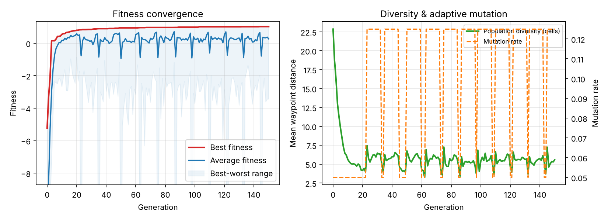
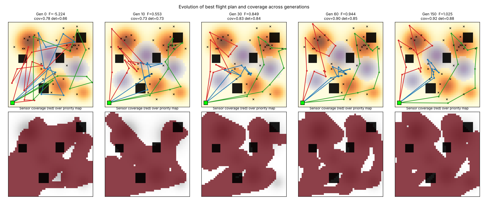
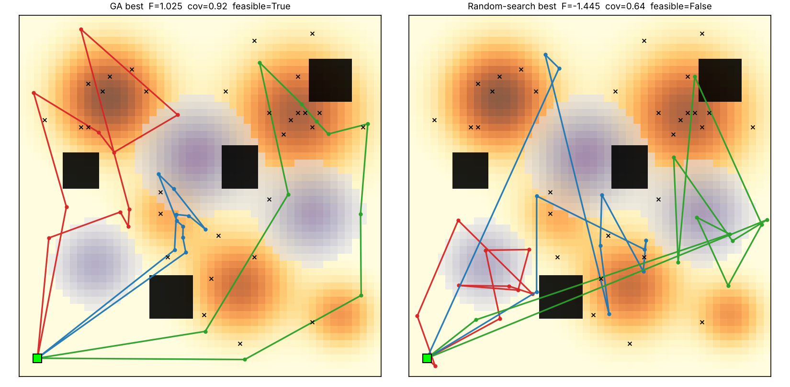

# 1. Problem and Approach

A fleet of three UAVs must survey a 50×50 hazard grid containing five priority disaster zones, three hazard pockets (wind/radiation), four no-fly blocks and 30 hidden targets (Fig. 1 of the repository, `outputs/00_environment.png`). All drones launch from and return to one base. The objectives conflict: wide, powerful sensing raises coverage but costs energy, flying faster saves time but burns more energy, and the best-covered areas lie next to hazards and no-fly zones. We therefore used a Genetic Algorithm (GA) that searches the trade-off surface and returns one balanced plan.

# 2. Chromosome Design and Rationale

We used a **hybrid real/binary encoding** for each drone *d* with *K* = 10 waypoints:

| Gene block | Type | Size | Meaning |
|---|---|---|---|
| waypoints (x, y) | real | K×2 | positions the UAV passes through |
| speed multiplier | real ∈ [0.6, 1.6] | K+1 | speed on each leg (incl. return leg) |
| sensor power | real ∈ [0, 1] | K+1 | footprint radius r = 2 + 4.5·p |
| sensor ON/OFF | binary | K+1 | allows the sensor to be switched off to save energy |

The route is *base → w₁ → … → w_K → base*, so the whole fleet is 3×(20+11+11+11) = 159 genes. Reasons for the design: (i) real coordinates avoid the coarse resolution of a grid-cell path and let operators make smooth spatial moves; (ii) the order of waypoints is the route, so tour-style operators (swap, reverse) apply; (iii) keeping speed, power and the on/off bit per leg lets the GA co-optimise *where*, *how fast* and *how strongly to sense* in one genome; (iv) a fixed genome length keeps crossover simple.

# 3. Multi-Objective Fitness Function

All terms are normalised to roughly [0, 1] and combined by weighted-sum scalarisation:

**F = w1·C + w2·D − w3·E − w4·T − w5·H − λ1·N − λ2·R**

* **C** – priority-weighted coverage: share of total priority value inside any sensor footprint.
* **D** – detection rate: priority-weighted expected detection, where a target at distance d from a sensor of radius r is detected with probability max(0, 1 − d²/r²).
* **E** – total energy over fleet budget; propulsion ∝ distance·(0.6 + 0.4·v²) plus sensor energy ∝ p²·time.
* **T** – mission makespan (slowest drone) over the time limit.
* **H** – hazard exposure: time spent in hazard cells weighted by intensity.
* **N, R** – constraint penalties (Section 5).

**Weights:** w1 = 1.0, w2 = 0.7, w3 = 0.3, w4 = 0.2, w5 = 0.45, λ1 = 6, λ2 = 3. Mission benefit (coverage, detection) carries the largest weight; hazard is weighted above energy and time because exposure risks losing the vehicle, while energy and time are already bounded by hard limits. The penalty weights are much larger than any benefit gain, so infeasible plans are never preferred once feasible ones exist. A Pareto method (e.g. NSGA-II) would give a front instead of one plan; we chose weighted-sum for transparency and note this as a limitation.

# 4. Genetic Operators

* **Selection:** tournament selection (size *k*), with elitism (4 %).
* **Crossover (per drone, chosen at random):** *segment swap* (exchange a run of waypoints and their legs), *geometric blend* (child = α·parent1 + (1 − α)·parent2), or *whole-route swap*; uniform crossover for the sensor bits. Probability 0.85.
* **Mutation:** Gaussian waypoint shift (σ = 4 cells), random waypoint reset (global jump), waypoint swap, sub-tour reversal (2-opt style), speed/power Gaussian tweak and sensor bit-flip.
* **Diversity preservation:** population diversity (mean waypoint distance between random pairs) is monitored every generation. When it falls below 4 cells, mutation is raised 2.5× and 8 % random immigrants are injected for 10 generations (a cool-down avoids toggling every generation).
* **Termination:** 150 generations, or 60 generations without improvement.

# 5. Constraint Handling

* **No-fly zones / map bounds – repair:** after every crossover and mutation, waypoints are clipped to the map and any waypoint inside a no-fly block is moved to the nearest free cell (distance-transform lookup). Because *legs* can still cross a block, each leg is sampled every 2 cells and the fraction of samples inside no-fly cells is penalised (λ1·N).
* **Range / flight-time limit – penalty:** each drone has a hard energy limit (260) and time limit (140). The normalised excess above either limit is penalised (λ2·R).
* All five final GA solutions were fully feasible (no-fly = 0, excess = 0); none of the five random-search solutions was.

# 6. Results

{width=5.2in}

Setup: population 100, 150 generations, tournament size 5, mutation rate 0.05, 5 independent seeds (about 14,500 fitness evaluations each). Best fitness rises from –5.2 (random initial population) to about 1.0 within 100 generations.

{width=6.2in}

In generation 0 the three routes cross the map in long, overlapping lines. By generation 30 each UAV has specialised: UAV 1 (red) takes the top-left disaster zone, UAV 3 (green) the top-right zone and the eastern edge, and UAV 2 (blue) the central cluster, with routes going around the purple hazard pockets and black no-fly blocks.

# 7. Hyperparameter Sensitivity Analysis

Each setting was run with 3 seeds for 80 generations (other parameters at the starting defaults: population 60, mutation 0.2, tournament 3). Values are final best fitness, mean ± std (`outputs/07_hyperparameter_sensitivity.png`).

| Population size | 20 | 50 | 100 | 200 |
|---|---|---|---|---|
| Fitness | 0.43 ± 0.12 | 0.47 ± 0.04 | 0.56 ± 0.05 | 0.67 ± 0.03 |
| *Evaluations* | 1.6k | 3.9k | 7.8k | 15.6k |

| Mutation rate | 0.02 | 0.10 | 0.20 | 0.40 |
|---|---|---|---|---|
| Fitness | 0.95 ± 0.01 | 0.82 ± 0.06 | 0.48 ± 0.04 | 0.08 ± 0.05 |

| Tournament size *k* | 2 | 3 | 5 | 10 |
|---|---|---|---|---|
| Fitness | 0.31 ± 0.03 | 0.48 ± 0.04 | 0.60 ± 0.08 | 0.79 ± 0.05 |

* **Population size:** larger populations improve quality and reduce run-to-run variance (std 0.12 → 0.03), but cost grows linearly (1.6k → 15.6k evaluations), so part of the gain is simply more evaluations. A population of 100 was our compromise.
* **Mutation rate:** this was the most sensitive parameter. With a 159-gene genome, a rate of 0.2 or 0.4 destroys good routes faster than selection can build them (the GA behaves like random search at 0.4). Low rates (0.02–0.1) work best because crossover already supplies large moves.
* **Selection pressure:** stronger selection (larger *k*) clearly helps within the 80-generation budget. We saw no premature convergence at *k* = 10 here, because the operators and diversity safeguard keep exploring; with much longer runs or a more deceptive landscape, very high *k* could lose diversity.
* **Consequence:** the study showed that our initial defaults (0.2 / *k* = 3) were poor, so for the final runs we changed them to mutation 0.05 and *k* = 5. These final settings were chosen from the sensitivity results and were not themselves swept, so they may not be optimal. Because the sweeps changed one parameter at a time, interactions between parameters are not captured.

# 8. Comparison with Random Search Baseline

Random search drew the same number of random plans as the GA used evaluations (about 14,500 per seed), using the same random-plan generator that creates the initial population.

| Metric (mean of 5 seeds) | GA | Random search |
|---|---|---|
| Fitness | **0.99** | –2.69 |
| Priority coverage | 92 % | 71 % |
| Detection rate | 88 % | 55 % |
| Energy / budget | 0.82 | 0.99 |
| Makespan / time limit | 0.84 | 1.46 |
| Hazard exposure (normalised) | 0.31 | 0.78 |
| Feasible plans | 5 / 5 | 0 / 5 |

{width=5.2in}

Random search finds plans that cover a lot of area (71 %) but always violates the time or no-fly limits, because in a 159-dimensional space a random point almost never satisfies all constraints at once. The GA solution is **structurally different**: each UAV owns a compact sector, routes bend around hazards and no-fly blocks, and sensors are tuned (not always at full power). The GA solutions are also *consistent but not identical*: the mean distance between nearest waypoints of solutions from different seeds is 4.2 cells for the GA versus 5.4 for random search. So the GA converges towards similar good regions (e.g. all cover the top-left and top-right zones) but each seed finds a different tour inside them. This is a modest difference and the measure is a rough one (it ignores drone identity and order). The multi-modal landscape therefore has several comparably good plans, as the problem statement suggests.

# 9. Limitations and Future Work

(1) Weighted-sum scalarisation gives one trade-off only; NSGA-II would return a Pareto front. (2) The diversity safeguard fires periodically at the settings used; its benefit was not isolated by an ablation. (3) Weights were set by judgement, not tuned. (4) Hazards and targets are static; a dynamic environment would require re-planning. (5) Results come from 5 seeds on one map.

# Reproduction

`pip install -r requirements.txt; python main.py; python experiments.py` – see `README.md`.
